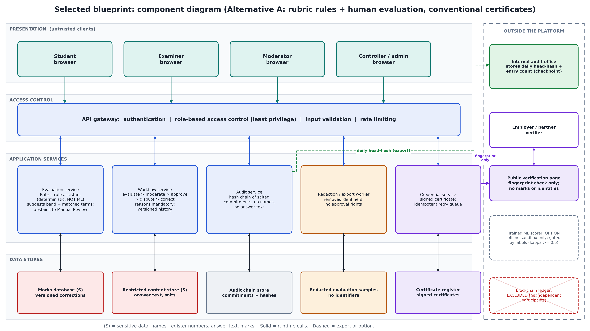
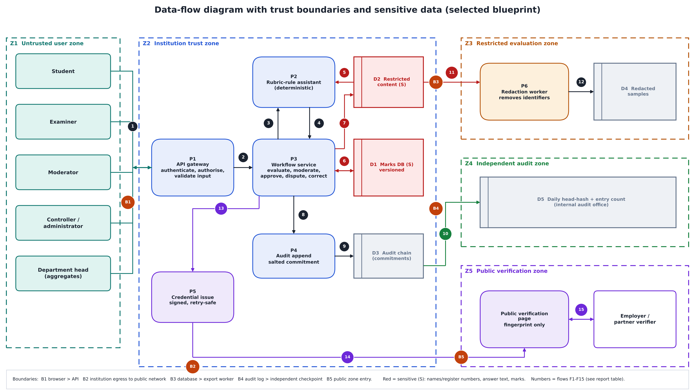
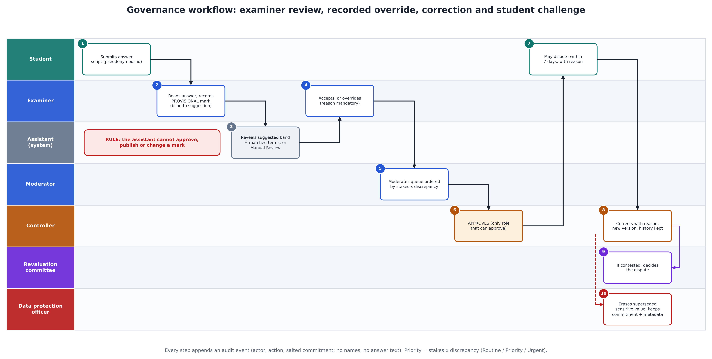

# Responsible Technology Adoption for an Examination and Credential Platform

CSA10 Software Engineering – Assignment 5 (CO5). A reproducible, **synthetic-data** demonstrator and the full report
comparing four options for an examination platform:

| | Alternative | Outcome |
|---|---|---|
| **A** | Conventional role-controlled database + explainable, abstaining **rubric rules** + human evaluation | **Selected** |
| B | Trained ML scoring assistance | Deferred behind data/agreement gates (evaluated, not implemented) |
| C | Blockchain shared credential verification | **Excluded** (evaluated, not implemented) |
| D | ML + Blockchain | Not selected |

> **Evidence status.** All data are synthetic. Results are illustrative evidence of displayed behaviour, not proof of
> production accuracy, performance, live monitoring or secure authorisation. No trained model and no ledger are implemented.

## Quick start (Python 3.10+, standard library only)

```bash
python3 run_demonstrator.py                 # writes results/results.json (deterministic) and results/timing.json (machine-specific)
python3 -m unittest discover -s tests -v    # 43 tests, incl. byte-for-byte reproduction of results.json
```

## What the demonstrator tests (claims were written *before* the first run – see `docs/predictions.md`)

| Claim | Result |
|---|---|
| C1 deterministic stakes-discrepancy matrix | PASS |
| C2a forced-choice baseline makes ≥ 6 wrong suggestions | PASS (9 wrong) |
| C2b abstaining assistant v1 makes ≤ 2 wrong suggestions | **FAIL** (4 wrong) → revision R1 |
| C2c v2 after R1 ≤ 2 wrong | 2 wrong (tuned on the same 24 answers – **not independent**) |
| C2d wrong rate ≤ 10% on answered items | **FAIL** (14.3%, 95% CI 4–40%) |
| C3 hash-chained audit log: detects naive edits; needs an external checkpoint for privileged rewrite/truncation; cannot verify input truth | PASS |
| C4 role-controlled workflow (assistant cannot approve; reasons mandatory; erasure keeps chain valid) | PASS (20 checks) |
| C5 retry-safe credential issue when the verifier is down | PASS |
| C6 label noise limits measurable agreement (simulation) | PASS |

Failures are reported, not hidden. Limitations: 24 crafted answers, one author, rubric lexicon by the same author.

## Layout

```
run_demonstrator.py      one command: all checks -> results/
demonstrator/            rubric.py  matrix.py  audit.py  workflow.py  credentials.py  simulation.py  selection.py  resources.py
data/                    synthetic_answers.csv  rubric_acid.json   (frozen with SHA-256 in docs/predictions.md)
tests/                   43 unit tests
results/                 results.json  timing.json  run_log.txt  unit_tests.txt
figures/                 architecture diagrams + charts (PNG, 250 dpi)
screenshots/             HD (2x) terminal screenshots rendered from the real run log
report/                  CSA10_Assignment5_Report.docx / .pdf
docs/                    predictions.md  evidence_index.md
tools/                   scripts that regenerate figures, screenshots and the report
```

## Selected blueprint





## Regenerating figures and the report (optional)

```bash
pip install -r requirements-report.txt && python -m playwright install chromium
python3 run_demonstrator.py && python3 -m unittest discover -s tests -v > results/unit_tests.txt 2>&1
python3 tools/make_charts.py && python3 tools/make_diagrams.py && python3 tools/make_screenshots.py && python3 tools/build_report.py
```

`results/timing.json` and the timing line in `run_log.txt` are machine-specific (single machine, not a benchmark);
every other number is deterministic (seed 2026).

## Honest scope

Scores in the decision matrix are ordinal planning judgements, not measurements. Costs other than rule-evaluation time are
estimates from stated assumptions. HMAC stands in for an asymmetric signature in the credential demo. The simulated stakeholder
responses are labelled as simulated.

MIT licence – see `LICENSE`.
